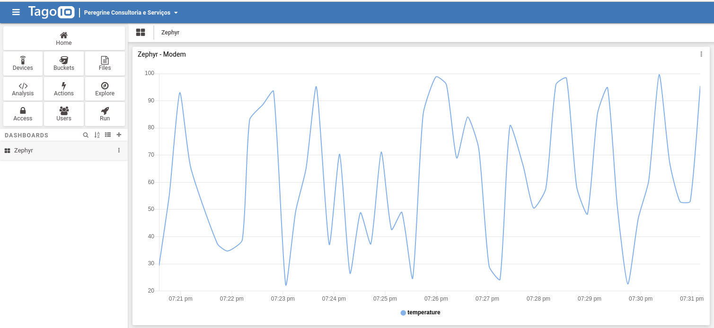
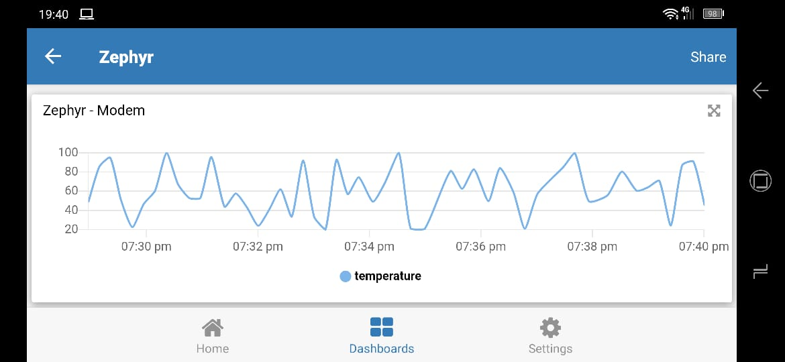

.. zephyr:code-sample:: tagoio-http-post
   :name: TagoIO HTTP Post
   :relevant-api: bsd_sockets http_client dns_resolve tls_credentials

   使用 HTTP 向 TagoIO IoT 云平台发送随机温度值。

概述
********

本示例应用程序实现了一个 HTTP 客户端，用于向 `TagoIO`_ IoT 服务平台发起 HTTP POST
请求。该示例通过发送随机温度值来模拟真实设备，可用于加速开发流程，并演示如何向
`TagoIO`_ 服务器发送简单的 JSON 数据。

本示例应用程序的源代码位于：
:zephyr_file:`samples/net/cloud/tagoio_http_post` 。

环境要求
************

- 一个免费的 `TagoIO`_ 账号
- 一块支持互联网连接的开发板，请参阅 :ref:`networking`
- 本示例提供了三种接入互联网的方式：

  * 以太网（Ethernet）：使用默认配置
  * Wi-Fi：使用默认配置并叠加 Wi-Fi overlay

TagoIO 设备配置
***************************

如果你还没有 `TagoIO`_ 账号，只需在 `TagoIO`_ 免费注册一个账号。随后添加一个设备，并选择
Custom HTTP(S) 协议即可。接下来查看你的设备 Token，该 Token 将在发送数据时用于标识你的设备。
你需要将该信息填入 :zephyr_file:`samples/net/cloud/tagoio_http_post/prj.conf` 文件中的
``CONFIG_TAGOIO_DEVICE_TOKEN`` 配置项。

构建与运行
********************

以太网
============

你可以在带有以太网端口的受支持开发板上运行本应用程序，例如 :zephyr:board:`sam4e_xpro` 、
:zephyr:board:`sam_v71_xult` 、 :zephyr:board:`frdm_k64f` 、 :zephyr:board:`nucleo_f767zi` 等。
任选其一，使用最小配置构建 tagoio-http-client 示例应用程序即可：

.. zephyr-app-commands::
   :zephyr-app: samples/net/cloud/tagoio_http_post
   :board: [sam4e_xpro | sam_v71_xult/samv71q21 | frdm_k64f | nucleo_f767zi]
   :goals: build flash
   :compact:

Wi-Fi
=====

如需启用 Wi-Fi 支持，你需要使用板载 Wi-Fi 的开发板（如 :zephyr:board:`disco_l475_iot1` ），
或者添加扩展板（Shield），如 :ref:`module_esp_8266` 或 :ref:`inventek_eswifi_shield` 。
此外，你还需要在 :zephyr_file:`samples/net/cloud/tagoio_http_post/overlay-wifi.conf` 文件中，
将你的 Wi-Fi 网络 SSID 填入 ``CONFIG_TAGOIO_HTTP_WIFI_SSID`` ，并将对应密码填入
``CONFIG_TAGOIO_HTTP_WIFI_PSK`` 。

.. zephyr-app-commands::
   :zephyr-app: samples/net/cloud/tagoio_http_post
   :board: disco_l475_iot1
   :gen-args: -DEXTRA_CONF_FILE=overlay-wifi.conf
   :goals: build flash
   :compact:

.. zephyr-app-commands::
   :zephyr-app: samples/net/cloud/tagoio_http_post
   :board: [sam_v71_xult/samv71q21 | frdm_k64f | nucleo_f767zi]
   :shield: [esp_8266_arduino | inventek_eswifi_arduino_uart]
   :gen-args: -DEXTRA_CONF_FILE=overlay-wifi.conf
   :goals: build flash
   :compact:

可视化 TagoIO 仪表盘
****************************

当控制台打印出日志后，就可以在 TagoIO 上创建仪表盘来可视化数据了。

* 访问 TagoIO Web 控制台
* 创建一个 Normal 类型的仪表盘，为其命名并进入下一步
* 添加一个折线图（Line Plot）。你将看到自己的设备，且系统会自动为你选中 temperature 变量
* 保存即可查看效果！

你还可以在手机或平板电脑上体验 TagoIO 移动应用程序。只需前往应用商店搜索 TagoIO，下载安装并登录即可使用！

更多信息请参阅 `TagoIO`_ 与 `TagoIO Documentation`_ 。

参考资料
************

.. target-notes::

.. _TagoIO:
   https://tago.io/

.. _TagoIO Documentation:
   https://docs.tago.io
